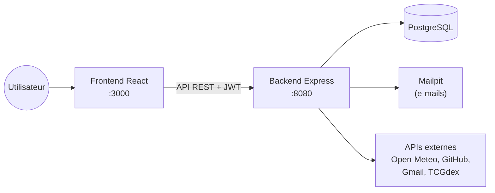

# Dashboard

Un tableau de bord personnel, présenté comme un tableau de liège couvert de post-it.
Chaque post-it est un **widget** : l'heure d'une ville, la météo, un dépôt GitHub, vos derniers e-mails, une carte Pokémon…
Chaque utilisateur compose son propre tableau, et les widgets se mettent à jour tout seuls.

## Sommaire

- [À quoi ça sert](#à-quoi-ça-sert)
- [Fonctionnalités](#fonctionnalités)
- [Services et widgets](#services-et-widgets)
- [Démarrage rapide](#démarrage-rapide)
- [Utilisation](#utilisation)
- [Technologies et structure](#technologies-et-structure)
- [Documentation](#documentation)

## À quoi ça sert

Le Dashboard regroupe sur une seule page des informations venant de plusieurs sources.
Il peut servir de page d'accueil du navigateur :

- **au quotidien** : l'heure de plusieurs fuseaux horaires, la météo de sa ville, le nombre d'e-mails non lus ;
- **pour un développeur** : les statistiques d'un dépôt GitHub et les notifications en attente ;
- **pour le plaisir** : une carte Pokémon tirée au hasard, à garder si elle plaît.

## Fonctionnalités

- **Comptes utilisateurs** : inscription par e-mail avec confirmation, ou connexion avec Google.
- **Comptes liés** : GitHub et Google sont reliés au compte du dashboard par OAuth 2.0, pour que les widgets accèdent à vos données.
- **Tableau personnalisable** : une grille de 6 × 5 cases où l'on ajoute, configure, déplace (glisser-déposer), redimensionne et supprime des post-it.
- **Widgets configurables** : chaque post-it a sa propre configuration. Deux widgets du même type peuvent afficher des informations différentes, par exemple la météo de deux villes.
- **Rafraîchissement automatique** : chaque widget se met à jour à la fréquence choisie (de 30 secondes à 1 heure).
- **API documentée** : toutes les routes sont décrites et testables sur Swagger UI.

## Services et widgets

5 services, 11 widgets. Le détail de chaque widget (paramètres, valeurs par défaut, comportement) est dans [docs/WIDGETS.md](docs/WIDGETS.md).

| Service | Widgets | Compte nécessaire |
|---|---|---|
| **Heure** (`time`) | `digital_clock`, `analog_clock` : l'heure d'un fuseau horaire | Aucun |
| **Météo** (`weather`) | `weather_current` : météo actuelle d'une ville<br>`weather_forecast` : prévisions sur plusieurs jours | Aucun |
| **Pokémon** (`pokemon`) | `pokemon_random_card` : une carte au hasard<br>`pokemon_card` : une carte choisie par son nom | Aucun |
| **GitHub** (`github`) | `github_repo` : statistiques d'un dépôt<br>`github_profile` : profil d'un utilisateur<br>`github_notifications` : notifications non lues | GitHub |
| **Gmail** (`gmail`) | `gmail_unread_count` : nombre d'e-mails non lus<br>`gmail_recent_threads` : derniers e-mails reçus | Google |

## Démarrage rapide

**Prérequis** : [Docker](https://docs.docker.com/get-docker/) avec Docker Compose.

```bash
# 1. Copier le modèle de configuration, puis le compléter (voir docs/INSTALLATION.md)
cp .env.example .env

# 2. Construire et lancer l'application
docker compose build
docker compose up -d
```

Au démarrage, le backend crée les tables de la base et remplit le catalogue des services et widgets : rien d'autre à faire.

| Adresse | Contenu |
|---|---|
| http://localhost:3000 | Application (frontend) |
| http://localhost:8080/about.json | Services et widgets proposés par le serveur |
| http://localhost:8080/api/docs | Documentation interactive de l'API (Swagger UI) |
| http://localhost:8025 | Mailpit : boîte de réception de développement (e-mails de confirmation) |

Sans configurer Google ni GitHub, l'application fonctionne avec les comptes par e-mail et les widgets Heure, Météo et Pokémon.
La configuration complète (OAuth, variables d'environnement, lancement sans Docker, dépannage) est décrite dans [docs/INSTALLATION.md](docs/INSTALLATION.md).

## Utilisation

1. Ouvrez http://localhost:3000 et créez un compte.
2. Confirmez votre adresse avec le lien reçu par e-mail (en local, il arrive dans Mailpit : http://localhost:8025).
3. Connectez-vous : votre tableau est vide.
4. Cliquez sur une case libre, choisissez une taille, puis un widget, et configurez-le.
5. Cliquez sur un post-it pour le modifier ou le supprimer ; faites-le glisser pour le déplacer.

Le guide complet, écran par écran, est dans [docs/USER_GUIDE.md](docs/USER_GUIDE.md).

## Technologies et structure

| Couche | Technologies |
|---|---|
| Frontend | React 19, Vite, Tailwind CSS 4, TypeScript |
| Backend | Node.js 22, Express 5, TypeScript |
| Données | PostgreSQL, Prisma ORM |
| Authentification | JWT, bcrypt, confirmation par e-mail (Nodemailer), OAuth 2.0 Google et GitHub |
| Documentation API | OpenAPI 3, Swagger UI |
| Tests et qualité | Vitest, Supertest, ESLint |
| Infrastructure | Docker Compose, Mailpit, GitHub Actions |



```text
.
├── backend/              API Express (port 8080)
│   ├── prisma/           schéma, migrations et seed de la base
│   └── src/
│       ├── config/       catalogue des services et widgets (source de /about.json)
│       ├── routes/       routes HTTP
│       ├── controllers/  lecture des requêtes et réponses HTTP
│       ├── services/     logique métier, OAuth, et un dossier par service de widgets
│       ├── docs/         documentation OpenAPI (swagger.yaml)
│       └── __tests__/    tests d'intégration
├── frontend/             application React (port 3000)
│   └── src/
│       ├── api/          appels au backend
│       ├── components/   écran de connexion, tableau, post-it et un dossier par widget
│       ├── hooks/        chargement et rafraîchissement des données
│       └── constants/    grille, fuseaux horaires, fréquences…
├── docs/                 documentation du projet
├── bonus/                raccourcis de développement facultatifs (Makefile)
└── docker-compose.yml    base de données, Mailpit, backend et frontend
```

## Documentation

| Document | Pour qui | Contenu |
|---|---|---|
| [Guide utilisateur](docs/USER_GUIDE.md) | Utilisateurs | Créer un compte, ajouter et gérer ses widgets |
| [Installation](docs/INSTALLATION.md) | Développeurs, évaluateurs | Installer, configurer (OAuth, variables d'environnement), dépanner |
| [Services et widgets](docs/WIDGETS.md) | Tous | Ce que fait chaque widget et comment le configurer |
| [Architecture](docs/ARCHITECTURE.md) | Développeurs | Structure du code, modèle de données, fonctionnement interne |
| [API](docs/API.md) | Développeurs | Routes de l'API, `about.json`, Swagger |
| [Développement](docs/DEVELOPMENT.md) | Contributeurs | Tests, qualité, CI, ajouter un nouveau widget |
| [Choix techniques](docs/TECHNICAL_CHOICES.md) | Évaluateurs, développeurs | Justification des technologies, impacts, alternatives |
| [Schéma de la base](docs/dashboard_db_schema.pdf) | Développeurs | Schéma de la base de données (PDF) |
