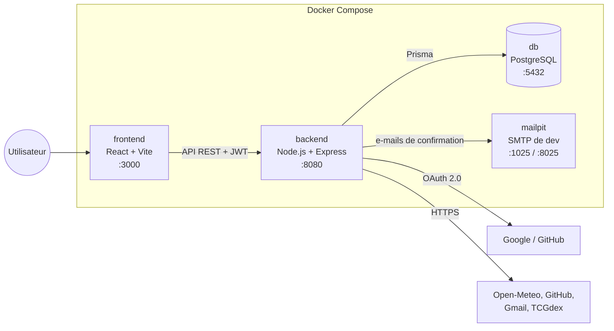
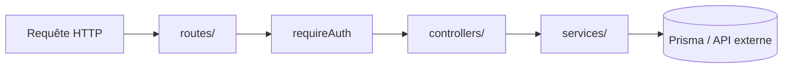
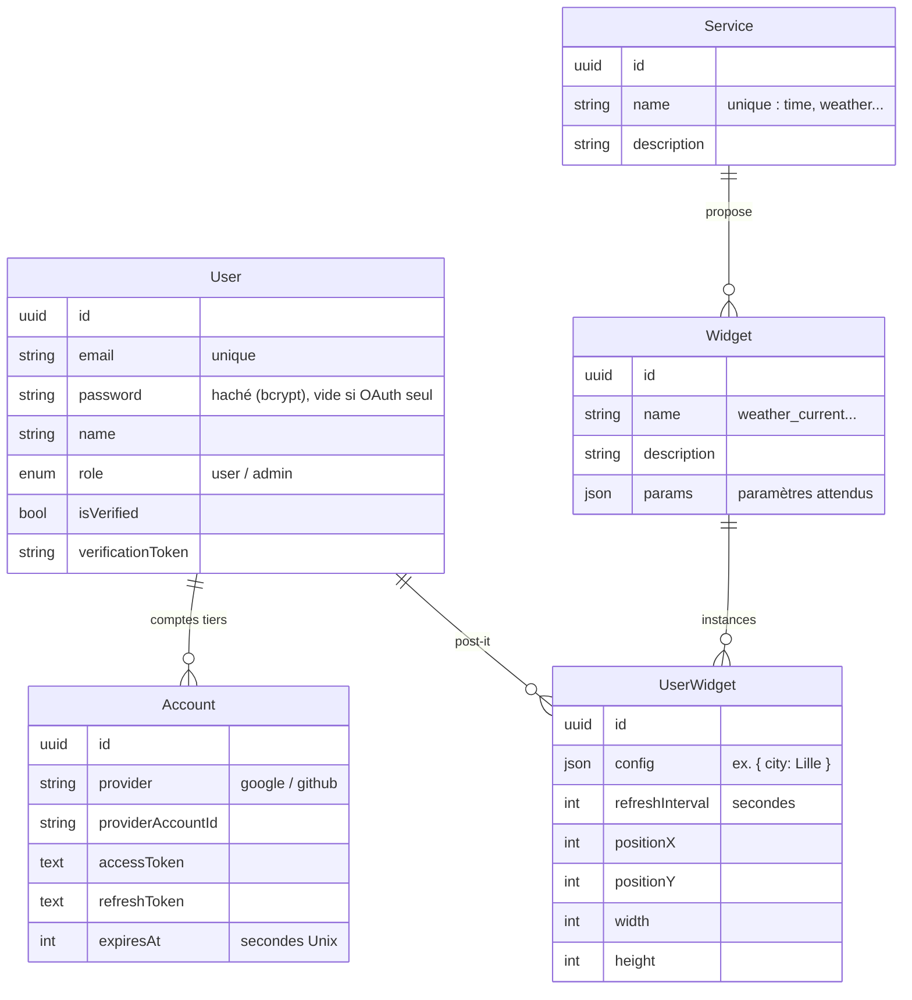
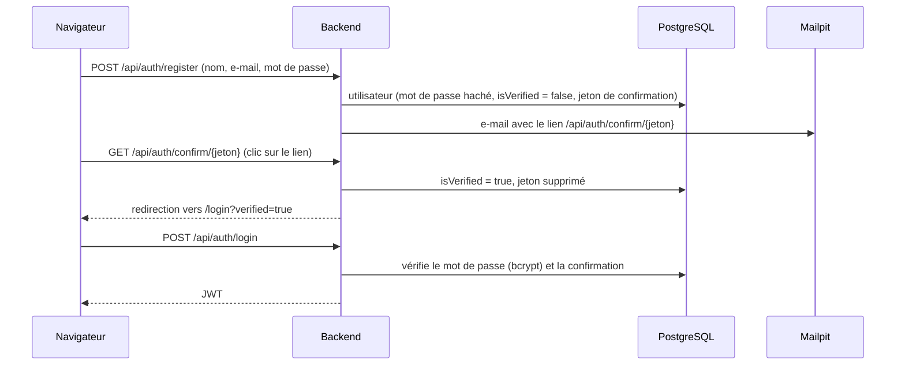
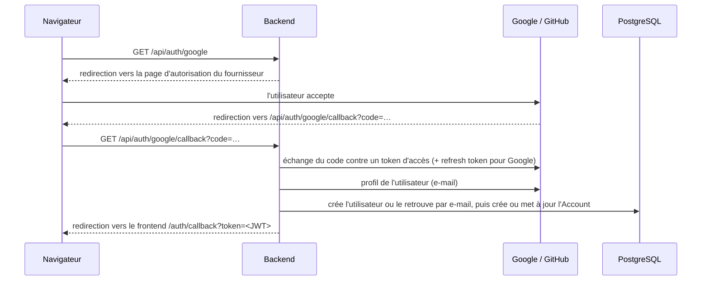
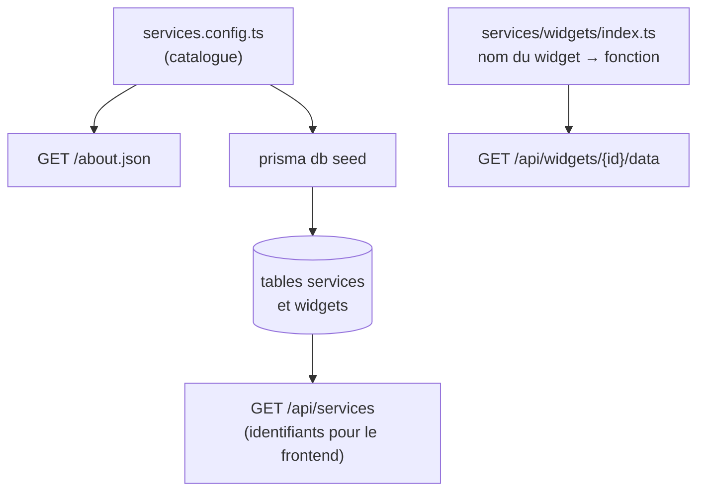
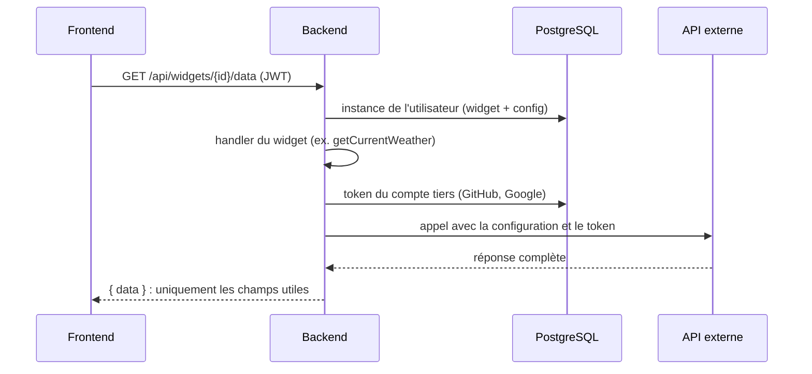
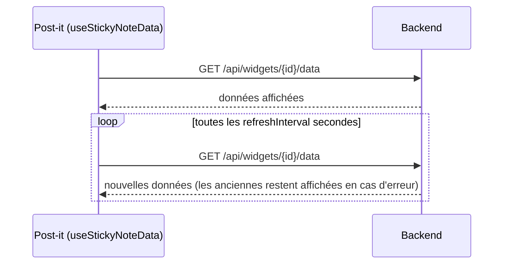

# Architecture

Ce document explique comment le Dashboard est construit : ses composants, l'organisation du code, le modèle de données et les principaux parcours (connexion, affichage d'un widget, rafraîchissement).
Pour la raison de chaque choix technique, voir [TECHNICAL_CHOICES.md](TECHNICAL_CHOICES.md).

## Sommaire

1. [Vue d'ensemble](#1-vue-densemble)
2. [Backend](#2-backend)
3. [Modèle de données](#3-modèle-de-données)
4. [Authentification](#4-authentification)
5. [Système de widgets](#5-système-de-widgets)
6. [Frontend](#6-frontend)
7. [Rafraîchissement des widgets (timer)](#7-rafraîchissement-des-widgets-timer)

---

## 1. Vue d'ensemble



| Composant | Rôle |
|---|---|
| **frontend** | Affiche la page de connexion et le tableau. Ne contient aucun secret : il dialogue uniquement avec le backend. |
| **backend** | Gère les comptes, les sessions, les instances de widgets, et appelle les services externes pour le compte de l'utilisateur. |
| **db** | Stocke les utilisateurs, leurs comptes tiers (tokens OAuth), le catalogue des widgets et les instances de chaque tableau. |
| **mailpit** | Reçoit les e-mails envoyés en développement (confirmation d'inscription) et les affiche dans une interface web. |

Principe central : **le navigateur ne parle jamais directement aux APIs externes** pour obtenir des données. Il demande au backend `GET /api/widgets/{id}/data`, et c'est le backend qui appelle le service tiers avec la configuration de l'instance et les tokens de l'utilisateur. Seules les images publiques (cartes Pokémon, avatars GitHub) sont chargées directement par le navigateur.

## 2. Backend

### 2.1 Organisation du code

```text
backend/
├── prisma/
│   ├── schema.prisma        modèle de données
│   ├── migrations/          historique des modifications de la base
│   └── seed.ts              copie le catalogue (services.config.ts) dans la base
└── src/
    ├── index.ts             démarrage du serveur (port 8080) + /api/health
    ├── app.ts               application Express : middlewares et montage des routes
    ├── config/
    │   └── services.config.ts   catalogue des services et widgets
    ├── routes/              associe chaque URL à un contrôleur
    ├── middlewares/
    │   └── requireAuth.ts   vérifie le JWT et ajoute req.user
    ├── controllers/         lit la requête, appelle un service, formate la réponse HTTP
    │   └── oauth/           redirections et retours OAuth Google et GitHub
    ├── services/            logique métier
    │   ├── auth.service.ts      inscription, confirmation, connexion
    │   ├── mail.service.ts      envoi des e-mails (Nodemailer)
    │   ├── widget.service.ts    instances de widgets de l'utilisateur
    │   ├── oauth/               échange des codes OAuth, liaison des comptes
    │   └── widgets/             un dossier par service de widgets
    │       ├── index.ts         table de correspondance nom du widget → fonction
    │       ├── time/  weather/  pokemon/  github/  gmail/
    │       └── google/          token Google partagé (renouvellement automatique)
    ├── lib/prisma.ts        client de base de données unique
    ├── docs/swagger.yaml    documentation OpenAPI
    └── __tests__/           tests d'intégration
```

### 2.2 Parcours d'une requête

Chaque requête traverse les mêmes couches, chacune avec un rôle unique :



| Couche | Responsabilité | Ne fait pas |
|---|---|---|
| `routes/` | Associer une URL et une méthode à un contrôleur, appliquer `requireAuth` | Aucune logique |
| `controllers/` | Vérifier les entrées, appeler le service, choisir le code HTTP | Accès direct à la base |
| `services/` | Logique métier, accès à la base et aux APIs externes | Connaître Express (`req`, `res`) |

Les services signalent les erreurs par un **code** (`throw new Error('CITY_NOT_FOUND')`). Le contrôleur traduit ce code en réponse HTTP grâce à une table (`WIDGET_DATA_ERRORS` dans `widget.controller.ts`), ce qui garde des messages cohérents pour tous les widgets.

### 2.3 Routes principales

| Préfixe | Fichier | Protégé par JWT |
|---|---|---|
| `/about.json` | `about.routes.ts` | Non |
| `/api/auth` | `auth.routes.ts`, `oauth.routes.ts` | Non |
| `/api/users` | `user.routes.ts` | Oui |
| `/api/services` | `service.routes.ts` | Oui |
| `/api/widgets` | `widget.routes.ts` | Oui |
| `/api/docs` | `docs.routes.ts` (Swagger UI) | Non |

Le détail de chaque route est dans [API.md](API.md).

## 3. Modèle de données



| Table | Contenu | Remplie par |
|---|---|---|
| `users` | Les comptes du Dashboard | Inscription ou première connexion OAuth |
| `accounts` | Les comptes Google / GitHub reliés et leurs tokens | Connexion OAuth (et renouvellement du token Google) |
| `services`, `widgets` | Le catalogue | Le seed, à partir de `services.config.ts` |
| `user_widgets` | Les post-it de chaque utilisateur : widget, configuration, fréquence, position et taille dans la grille | Le tableau (ajout, modification, déplacement) |

- **Suppression en cascade** : supprimer un utilisateur supprime ses comptes reliés et ses post-it.
- **Configuration en JSON** : chaque widget a des paramètres différents ; la colonne `config` les accueille sans changer le schéma.
- Un schéma visuel est aussi disponible dans [dashboard_db_schema.pdf](dashboard_db_schema.pdf).

## 4. Authentification

Deux mécanismes, comme le demande le sujet :
- l'**authentification** identifie l'utilisateur du Dashboard (e-mail et mot de passe, ou Google) ;
- l'**autorisation** permet aux widgets d'accéder à ses données chez Google et GitHub (OAuth 2.0).

Dans les deux cas, le résultat est le même : un **JWT** signé par le backend, valable 24 h, contenant l'identifiant et le rôle de l'utilisateur. Le frontend le garde dans le `localStorage` et l'envoie dans l'en-tête `Authorization: Bearer <token>`.

### 4.1 Inscription et connexion par e-mail



### 4.2 Connexion et liaison OAuth (Google, GitHub)



- **Liaison des comptes** : si l'e-mail du compte Google ou GitHub correspond à un utilisateur existant, le compte tiers lui est rattaché (`syncOAuthUserAndSignJwt` dans `services/oauth/oauth.shared.ts`) ; aucun doublon n'est créé.
- **Tokens tiers** : ils restent dans la table `accounts` et ne sont jamais envoyés au navigateur.
- **Renouvellement Google** : un token Google expire après une heure. Avant chaque appel, `getGoogleToken` (`services/widgets/google/googleApi.ts`) vérifie son expiration et le renouvelle avec le `refresh_token` si besoin. Les tokens GitHub n'expirent pas.

## 5. Système de widgets

### 5.1 Une seule déclaration, trois usages



- `services.config.ts` décrit chaque service, ses widgets et leurs paramètres. Il alimente `/about.json` et, via le seed, la base.
- `services/widgets/index.ts` associe chaque nom de widget à sa fonction (*handler*).
- Un handler a toujours la même forme : il reçoit la configuration de l'instance et l'identifiant de l'utilisateur, et renvoie les données à afficher.

```ts
type WidgetHandler = (config: Record<string, unknown>, userId: string) => Promise<unknown>;
```

### 5.2 Obtenir les données d'un widget



Chaque service a un petit module client qui centralise les appels et la traduction des erreurs : `openMeteo.ts`, `tcgdex.ts`, `githubApi.ts`, `googleApi.ts`.

| Code d'erreur | Réponse HTTP | Exemple |
|---|---|---|
| `INVALID_WIDGET_CONFIG` | 400 | Dépôt GitHub au mauvais format |
| `CITY_NOT_FOUND`, `GITHUB_NOT_FOUND`, `POKEMON_CARD_NOT_FOUND` | 400 | Ressource introuvable |
| `GITHUB_NOT_LINKED`, `GOOGLE_NOT_LINKED` | 403 | Compte tiers non relié |
| `GITHUB_TOKEN_INVALID`, `GOOGLE_TOKEN_INVALID` | 403 | Autorisation expirée ou révoquée |
| `GITHUB_FORBIDDEN`, `GOOGLE_FORBIDDEN` | 403 | Permission manquante |
| `GITHUB_RATE_LIMITED`, `GOOGLE_RATE_LIMITED` | 429 | Trop de requêtes |
| `UPSTREAM_ERROR` | 502 | Service externe indisponible |

## 6. Frontend

### 6.1 Organisation du code

```text
frontend/src/
├── main.tsx, App.tsx      point d'entrée ; App affiche la connexion ou le tableau selon la présence du JWT
├── api/
│   ├── client.ts          adresse du backend, JWT dans le localStorage
│   └── stickyNotes.ts     appels /api/widgets et /api/services, conversion post-it ↔ instance de widget
├── hooks/
│   ├── useStickyNotes.ts  état du tableau : chargement, ajout, déplacement, redimensionnement, suppression
│   └── useStickyNoteData.ts  chargement et rafraîchissement des données d'un post-it
├── components/
│   ├── LoginPage.tsx      connexion, inscription, retour OAuth
│   └── dashboard/
│       ├── Dashboard.tsx              grille et enchaînement des fenêtres
│       ├── StickyNoteCard.tsx         un post-it : glisser-déposer et choix du contenu à afficher
│       ├── StickyNote*Dialog.tsx      fenêtres taille, contenu et modification
│       ├── RefreshIntervalPicker.tsx  choix de la fréquence
│       ├── CountSlider.tsx            curseur pour choisir un nombre (notifications, e-mails…)
│       ├── accountLink.ts             redirection vers Google / GitHub si le compte n'est pas relié
│       └── clock/ weather/ pokemon/ github/ gmail/   affichage et options de chaque widget
├── constants/             grille (6 × 5), tailles, fuseaux horaires, fréquences, langues…
└── types/stickyNote.ts    types du tableau (position, taille, contenu)
```

### 6.2 Du post-it à l'instance de widget

Dans le frontend, un post-it est une **instance de widget** enregistrée par le backend :

| Côté frontend (`StickyNote`) | Côté backend (`UserWidget`) |
|---|---|
| `content.kind` (ex. `weatherCurrent`) | widget du catalogue (ex. `weather_current`) |
| `content` (ex. `{ city: 'Lille' }`) | `config` |
| `column`, `row` | `positionX`, `positionY` |
| `columns`, `rows` | `width`, `height` |
| `refreshInterval` | `refreshInterval` |

La correspondance est faite dans `api/stickyNotes.ts` (`catalogNames`, `toContent`, `toConfig`).
Au chargement, le frontend récupère le catalogue (`GET /api/services`) pour connaître l'identifiant de chaque widget, puis les post-it de l'utilisateur (`GET /api/widgets`).

### 6.3 Affichage adaptatif

Chaque widget existe en trois tailles (1 × 1, 2 × 2, 3 × 2) et adapte son contenu à la place disponible.
Les tailles de texte utilisent les unités de conteneur CSS (`cqmin`) : le contenu grandit ou rétrécit avec le post-it, sans code spécifique à chaque taille.

## 7. Rafraîchissement des widgets (timer)

Le timer est côté navigateur : chaque post-it affiché lance son propre minuteur (`setInterval`) avec la fréquence de son instance.



- La fréquence est choisie dans la fenêtre de configuration et enregistrée avec l'instance (`refreshInterval`, minimum 5 secondes côté API).
- Changer la fréquence relance immédiatement le minuteur du post-it.
- Le minuteur s'arrête quand le post-it est supprimé ou que la page est fermée : aucun appel n'est fait pour un tableau qui n'est pas affiché.
- L'horloge se met à jour chaque seconde sans appel au backend ; les cartes Pokémon ne changent qu'à la demande.
