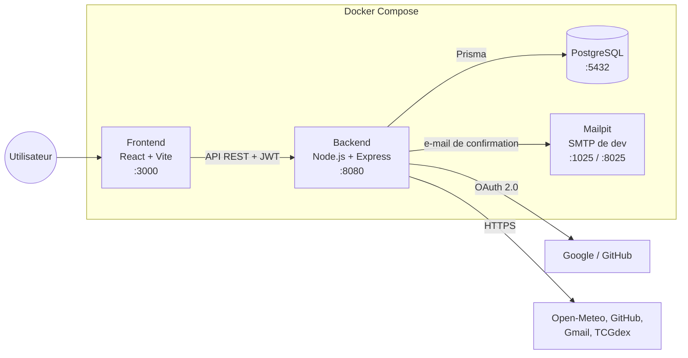

# Choix techniques

Ce document présente la stack technique du Dashboard, la raison de chaque choix, son impact sur le projet et les alternatives étudiées.
Le fonctionnement détaillé est décrit dans [ARCHITECTURE.md](ARCHITECTURE.md) ; la liste des documents est dans le [README](../README.md#documentation).

## Sommaire

- [Choix techniques](#choix-techniques)
  - [Sommaire](#sommaire)
  - [1. Contraintes de départ](#1-contraintes-de-départ)
  - [2. Vue d'ensemble](#2-vue-densemble)
  - [3. Langage : TypeScript partout](#3-langage--typescript-partout)
  - [4. Backend : Node.js et Express](#4-backend--nodejs-et-express)
  - [5. Base de données : PostgreSQL et Prisma](#5-base-de-données--postgresql-et-prisma)
  - [9. Frontend : React, Vite et Tailwind CSS](#9-frontend--react-vite-et-tailwind-css)

---

## 1. Contraintes de départ

Les choix ci-dessous découlent de ces contraintes, imposées par le sujet ou par le contexte du projet.

| Contrainte | Conséquence sur les choix |
|---|---|
| Le projet doit se construire et se lancer avec `docker-compose build` et `docker-compose up` | Chaque brique (base, backend, frontend, e-mails) doit tourner dans un conteneur |
| Le serveur doit répondre sur le port 8080, dont `GET /about.json` qui liste services, widgets et paramètres | Le catalogue des widgets doit être décrit à un seul endroit, lisible par le code |
| Inscription avec confirmation, authentification par identifiants ou OIDC, accès aux services tiers par OAuth 2.0 | Besoin d'envoi d'e-mails, de gestion de sessions et de stockage de tokens tiers |
| Pour une équipe de 2 : au moins 3 services et 6 widgets, chacun configurable | L'ajout d'un widget doit être rapide et ne pas dupliquer de code |
| Un timer rafraîchit chaque instance de widget selon sa fréquence | Chaque instance a sa propre configuration et son propre cycle de rafraîchissement |
| Données personnelles et identifiants « à manipuler avec une extrême prudence » | Les secrets restent côté serveur, les permissions demandées sont minimales |
| Interface responsive et accessible | Framework UI à composants, styles adaptables |
| Équipe de 2 personnes, délai court | Préférence pour des outils répandus, bien documentés, avec peu de configuration |

## 2. Vue d'ensemble

| Couche | Technologies |
|---|---|
| Frontend | React 19, Vite 8, Tailwind CSS 4, lucide-react, TypeScript |
| Backend | Node.js 22, Express 5, TypeScript, jsonwebtoken, bcrypt, Nodemailer |
| Données | PostgreSQL, Prisma ORM 6 |
| Documentation API | OpenAPI 3 (YAML), swagger-ui-express |
| Tests et qualité | Vitest, Supertest, ESLint, `tsc --noEmit` |
| Infrastructure | Docker, Docker Compose, Mailpit, GitHub Actions |

Le frontend n'appelle jamais directement les APIs externes : il demande les données d'un widget au backend (`GET /api/widgets/{id}/data`), qui appelle le service tiers avec la configuration de l'instance et les tokens de l'utilisateur. Seules les images publiques renvoyées dans ces données (cartes Pokémon, avatars GitHub) sont chargées directement par le navigateur.

---

## 3. Langage : TypeScript partout

**Choix :** TypeScript pour le backend et le frontend.

**Justification**
- Un seul langage pour toute l'application : les deux membres de l'équipe peuvent travailler sur les deux côtés sans changer d'outillage.
- Le typage détecte à la compilation les erreurs les plus fréquentes dans ce projet : champ mal nommé dans une réponse d'API, configuration de widget incomplète, oubli d'un cas d'erreur.
- Écosystème npm très fourni pour tous nos besoins (HTTP, ORM, OAuth, tests).

**Impact**
- ➕ Les réponses des APIs externes sont décrites par des interfaces (`GithubRepoResponse`, `CurrentWeatherResponse`…) : un changement de format se voit à la compilation et non en production.
- ➕ La CI bloque toute erreur de type (`tsc --noEmit`) avant la fusion.
- ➖ Une étape de compilation et un outil d'exécution en développement (`tsx`) en plus.
- ➖ Les types ne sont pas partagés automatiquement entre frontend et backend : le format des données d'un widget est décrit deux fois.

**Alternatives étudiées**

| Alternative | Pourquoi elle n'a pas été retenue |
|---|---|
| JavaScript | Même écosystème, mais sans vérification de types : erreurs découvertes à l'exécution |
| Python (Django / FastAPI) | Solide côté API, mais impose un second langage pour le frontend React |
| PHP (Laravel) | Framework complet et productif, mais second langage et moins adapté à une interface très interactive |
| Java / Kotlin (Spring Boot) | Robuste, mais plus verbeux et plus lent à mettre en place pour une équipe de 2 sur un délai court |

---

## 4. Backend : Node.js et Express

**Choix :** Node.js 22 avec Express 5, organisé en couches `routes → controllers → services`.

**Justification**
- Le travail du backend est surtout d'attendre des réponses : base de données, APIs externes, serveurs OAuth. Le modèle asynchrone de Node.js est adapté à ce type de charge.
- Express est minimal : on n'ajoute que ce dont on a besoin (`cors`, un middleware `requireAuth`, la documentation Swagger).
- Express 5 transmet automatiquement les erreurs des fonctions `async` au gestionnaire d'erreurs.
- Un middleware d'authentification unique protège toutes les routes privées (`router.use(requireAuth)`).

**Impact**
- ➕ Démarrage rapide, peu de concepts à apprendre, très bien documenté.
- ➕ Chaque widget est une simple fonction asynchrone : facile à écrire et à tester.
- ➖ Aucune structure imposée : la séparation `routes / controllers / services` repose sur la discipline de l'équipe.
- ➖ Pas de validation automatique des requêtes : les contrôleurs vérifient les entrées à la main (ex. `refreshInterval`, `widgetId`).

**Alternatives étudiées**

| Alternative | Pourquoi elle n'a pas été retenue |
|---|---|
| NestJS | Architecture modulaire, injection de dépendances et validation intégrées, mais beaucoup de concepts (modules, décorateurs, providers) pour un projet de cette taille |
| Fastify | Plus rapide et validation par schéma intégrée ; la performance brute n'est pas un enjeu ici et l'écosystème d'exemples est plus restreint |
| Hono | Très léger et moderne, mais communauté et documentation encore plus réduites |

---

## 5. Base de données : PostgreSQL et Prisma

**Choix :** PostgreSQL comme base, Prisma comme ORM (schéma, migrations, seed).

**Justification**
- Les données sont **relationnelles** : un utilisateur a des comptes tiers (`Account`) et des instances de widgets (`UserWidget`), chaque instance pointe vers un widget du catalogue (`Widget`), lui-même rattaché à un service (`Service`). Les clés étrangères et la suppression en cascade garantissent la cohérence (supprimer un utilisateur supprime ses widgets et ses tokens).
- La **configuration d'un widget varie selon son type** (`{ city }`, `{ repository }`, `{ name, language }`…). PostgreSQL la stocke dans une colonne `JSON` : on garde la rigueur relationnelle pour la structure et la souplesse pour la configuration, sans nouvelle migration pour chaque widget.
- Prisma génère un client typé à partir de `schema.prisma` : une requête qui ne correspond plus au schéma ne compile pas.
- Les migrations versionnées (`prisma/migrations`) sont appliquées automatiquement au démarrage du conteneur (`prisma migrate deploy`) et en CI.
- Le seed (`prisma/seed.ts`) remplit le catalogue à partir du même fichier que `/about.json` (`services.config.ts`). Il est relancé à chaque démarrage du conteneur et met à jour les entrées existantes au lieu de les dupliquer : un `docker compose up` suffit pour une application complète.

**Impact**
- ➕ Intégrité des données assurée par la base, pas seulement par le code.
- ➕ Ajouter un widget ne demande aucune migration : il suffit de le déclarer et de relancer le seed.
- ➖ La colonne `config` n'est pas validée par la base : chaque handler doit vérifier la configuration qu'il reçoit (`INVALID_WIDGET_CONFIG`).
- ➖ Un service PostgreSQL de plus à faire tourner, alors que SQLite tiendrait dans un fichier.

**Alternatives étudiées**

| Alternative | Pourquoi elle n'a pas été retenue |
|---|---|
| MongoDB | Souple pour les configurations de widgets, mais les relations utilisateur / comptes / widgets demanderaient de gérer la cohérence à la main |
| MySQL / MariaDB | Équivalent pour notre usage ; PostgreSQL offre un meilleur support du JSON et est le choix par défaut de Prisma |
| SQLite | Aucun serveur à gérer, mais accès concurrents limités et éloigné d'un déploiement réel |
| TypeORM / Sequelize | ORM plus anciens, typage moins fiable et migrations plus manuelles |
| Drizzle ORM | Léger et très bien typé, mais plus jeune, avec moins de documentation et d'outils (pas d'équivalent à Prisma Studio) |
| Requêtes SQL brutes (`pg`) | Contrôle total, mais pas de typage des résultats ni de gestion des migrations |

## 9. Frontend : React, Vite et Tailwind CSS

**Choix :** React 19 avec Vite 8, Tailwind CSS 4 pour les styles, lucide-react pour les icônes. Pas de bibliothèque de routage ni de gestion d'état : des hooks React (`useStickyNotes`, `useStickyNoteData`) et un module d'appels API (`src/api`).

**Justification**
- Un dashboard est un assemblage de **composants indépendants** qui se rafraîchissent chacun de leur côté : c'est le modèle de React.
- Vite démarre en quelques centaines de millisecondes et recharge instantanément les modifications.
- Tailwind permet d'adapter chaque widget à la taille de son post-it (unités de conteneur `cqmin`) directement dans le JSX, sans multiplier les fichiers CSS.
- lucide-react fournit des icônes SVG légères, importées une par une.
- L'application n'a que deux écrans (connexion, dashboard) : un routeur ou un store global n'apportait pas assez pour justifier une dépendance de plus.

**Impact**
- ➕ Peu de dépendances (4 en production) : moins de mises à jour et de failles potentielles.
- ➕ Les widgets s'adaptent à trois tailles de post-it sans code CSS spécifique.
- ➖ Les classes Tailwind rendent certains composants longs à lire.
- ➖ Le routage est fait à la main (`window.location`) : il faudra une vraie bibliothèque si des pages s'ajoutent (profil, administration).

**Alternatives étudiées**

| Alternative | Pourquoi elle n'a pas été retenue |
|---|---|
| Vue.js | Plus simple à prendre en main, mais écosystème de composants plus restreint |
| Angular | Très structuré, mais lourd (modules, RxJS, injection de dépendances) pour une application de deux écrans |
| Svelte | Très performant, mais communauté et bibliothèques plus réduites |
| Next.js | Rendu serveur inutile pour un dashboard privé derrière une authentification, et doublon avec notre backend Express |
| Bootstrap / Material UI | Composants prêts à l'emploi, mais un style générique difficile à adapter à l'esthétique « post-it » du dashboard |
| Create React App | Officiellement abandonné, remplacé par Vite |
